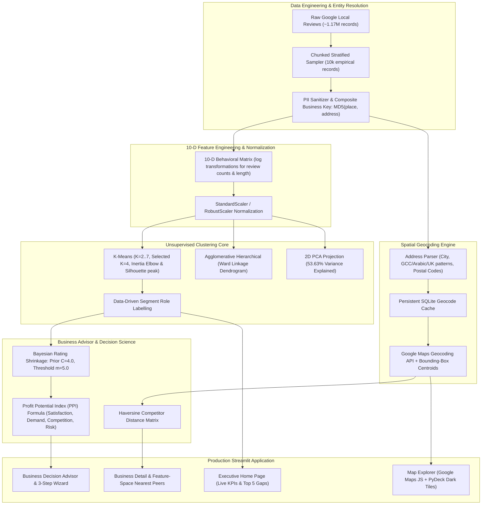

# UrbanPulse AI: Commercial Intelligence & Business Review Pattern Segmentation

[](https://github.com/Jayant-Hu/Business-Review-Pattern-Segmentation-Using-Clustering/actions/workflows/ci.yml)
[](https://www.python.org/downloads/)
[](https://opensource.org/licenses/MIT)
[](https://streamlit.io)
[](tests/)

**UrbanPulse AI** is a production-grade, enterprise Unsupervised Machine Learning platform and civic intelligence system. Built over ~1.17M raw Google Local commercial reviews (with a 10,000 stratified empirical sample across 3,276 commercial venues), the platform segments establishments based on multidimensional behavioral review patterns, uncovers commercial opportunity gaps using Bayesian demand scoring, and provides interactive spatial analytics with Google Maps and PyDeck integration.

---

## 🏛️ System Architecture



---

## ⚡ Discovered Segments & Empirical Baselines

| Cluster | Discovered Segment Role | Establishments | Avg Rating | Neg % | Strategic Action |
|:---:|:---|:---:|:---:|:---:|:---|
| **0** | **High-Satisfaction Top Tier** | 1,836 (56.0%) | 4.57 ⭐ | 0.1% | Civic showcase, tourism guides, fast-track permits |
| **1** | **Moderate / Mixed Feedback** | 487 (14.9%) | 4.33 ⭐ | 0.0% | Digital marketing workshops, repeat traffic incentives |
| **2** | **High-Engagement Detailed Feedback** | 157 (4.8%) | 3.81 ⭐ | 14.7% | Operational benchmarking, staff training grants |
| **3** | **Critical Intervention / At-Risk** | 796 (24.3%) | 2.33 ⭐ | 45.6% | Health audits, license inspection reviews, compliance training |

---

## 🎯 Flagship Feature: Business Decision Advisor

The **Business Decision Advisor** helps entrepreneurs, city planners, and investors evaluate commercial viability using empirical review behavior as demand proxies:

### 3-Step Guided Strategy Wizard:
1. **Step 1: Choose Location**: Select a GCC city or evaluate across the entire regional market.
2. **Step 2: Define Preferences**: Pick a category focus, set confidence thresholds, and select competition tolerance.
3. **Step 3: Analyze Opportunities**: View ranked business categories scored via the **Profit Potential Index (PPI)**.

### Profit Potential Index (PPI) Formula:
$$\text{PPI} = w_{\text{sat}} \cdot S_{\text{sat}} + w_{\text{dem}} \cdot S_{\text{dem}} + w_{\text{comp}} \cdot S_{\text{comp}} - w_{\text{risk}} \cdot P_{\text{risk}}$$

- **Satisfaction ($S_{\text{sat}}$)**: Weighted blend of Bayesian-shrunk rating $\hat{R} = \frac{v}{v+m}R + \frac{m}{v+m}C$ and positive review share.
- **Demand Velocity ($S_{\text{dem}}$)**: Log-normalized reviews per business.
- **Competition ($S_{\text{comp}}$)**: Inverse saturation index measuring local unmet demand.
- **Risk Penalty ($P_{\text{risk}}$)**: Standard deviation of customer ratings combined with at-risk cohort shares.

### Strategic Opportunity Archetypes:
- **Proven Market**: High demand volume + high customer satisfaction ratings.
- **Underserved Gap**: High review volume per venue + low competitor saturation.
- **Quality Gap**: Active consumer demand with depressed average ratings (clear opening for quality).
- **Saturated**: High establishment count with fragmented review volume.
- **Weak Demand**: Low customer activity and low satisfaction.

---

## 🔍 Feature: Business Detail & Behavioral Peer Discovery

- **Global Autocomplete Directory**: Filter commercial venues by name, category, or city.
- **Establishment KPI Dossier**: Bayesian score, review volume, satisfaction spread, and consistency ($\pm\sigma$).
- **Local Cohort Standing**: Relative percentile ranking within the establishment's city and category.
- **Feature-Space Nearest Peers**: Euclidean distance matching across the 10-dimensional scaled feature space to discover true operational competitors.
- **Executive Dossier Export**: Generate one-click commercial profile reports as structured PDF documents.

---

## 🎨 Design System & UI/UX Standards

The user interface follows a modern SaaS dark-navy aesthetic:
- **Design Tokens**: Standardized CSS custom properties in `src/ui/styles.py`.
- **Light / Dark Mode Engine**: Instant display theme toggle in the sidebar navigation.
- **Grouped Sidebar Navigation**: Organised into *Explore*, *Decide*, *Analyze*, and *Methodology*.
- **Persistent Global Filter Ribbon**: Seamlessly slice data by City, Category, Segment, and Review Volume across analytical pages.
- **Every Chart**: Clear titles, units, auto-generated data insights, and expandable "ℹ️" help popovers.
- **Zero Hardcoded Metrics**: All statistics, counts, and percentiles are computed dynamically from data files.

---

## ⚠️ Mandatory Honesty Rule & Operating Principle

> **Model Reality Notice**:
> *"The metrics and scores provided across this platform are based on customer review behaviour as an empirical demand and satisfaction proxy; they do not constitute a financial forecast or an audit of company revenues. Users must validate recommendations with comprehensive local market research, footfall surveys, and financial due diligence before investing capital."*

---

## 🚀 Getting Started

### 1. Prerequisites & Environment Setup
```bash
git clone https://github.com/Jayant-Hu/Business-Review-Pattern-Segmentation-Using-Clustering.git
cd Business-Review-Pattern-Segmentation-Using-Clustering

# Create and activate virtual environment
python -m venv .venv
source .venv/bin/activate  # Windows: .venv\Scripts\activate

# Install dependencies
pip install -r requirements.txt
pip install -r requirements-dev.txt
```

### 2. Environment Configuration
Copy `.env.example` to `.env`:
```bash
cp .env.example .env
```
*(Optional: Add your `GOOGLE_MAPS_API_KEY`. If left empty, the application falls back gracefully to PyDeck / OpenStreetMap).*

### 3. Run Pipeline CLI
```bash
python scripts/run_pipeline.py --step all
```

### 4. Launch Streamlit Application
```bash
streamlit run app.py
```
Open **[http://localhost:8501](http://localhost:8501)** in your browser.

---

## 🧪 Automated Testing Suite

Run the full pytest suite (24 tests):
```bash
pytest tests/ -v
```
All unit tests validate:
- Schema validation & composite key entity resolution
- Model determinism & cluster stability ($ARI = 0.9986$)
- Bayesian rating shrinkage & PPI monotonicity
- Weight slider re-ranking sensitivity
- PII sanitization (email, phone, URL, handle masking)
- Haversine geodesic distance matrix
- Break-even financial estimation logic
- Full PDF generation for Advisor and Business Dossiers

---

## 📂 Project Structure

```
├── app.py                      # Main entrypoint and page router
├── config.py / settings.py     # Pydantic-settings typed configuration
├── src/
│   ├── data/                   # loader.py, cleaning.py, schema.py
│   ├── features/               # business_features.py (10-D aggregation)
│   ├── models/                 # kmeans.py, hierarchical.py, pca.py, stability.py
│   ├── geo/                    # city_parser.py, geocoder.py, cache.py
│   ├── services/               # analytics.py, decision_advisor.py, business_lookup.py
│   ├── ui/                     # styles.py, theme.py, components.py, navigation.py, charts.py
│   └── pages/                  # 14 modular page renderers
├── scripts/                    # run_pipeline.py (CLI orchestration)
├── tests/                      # 24 pytest unit and integration tests
├── Dockerfile                  # Production container image
└── pyproject.toml              # Build, ruff, black, and pytest configuration
```
