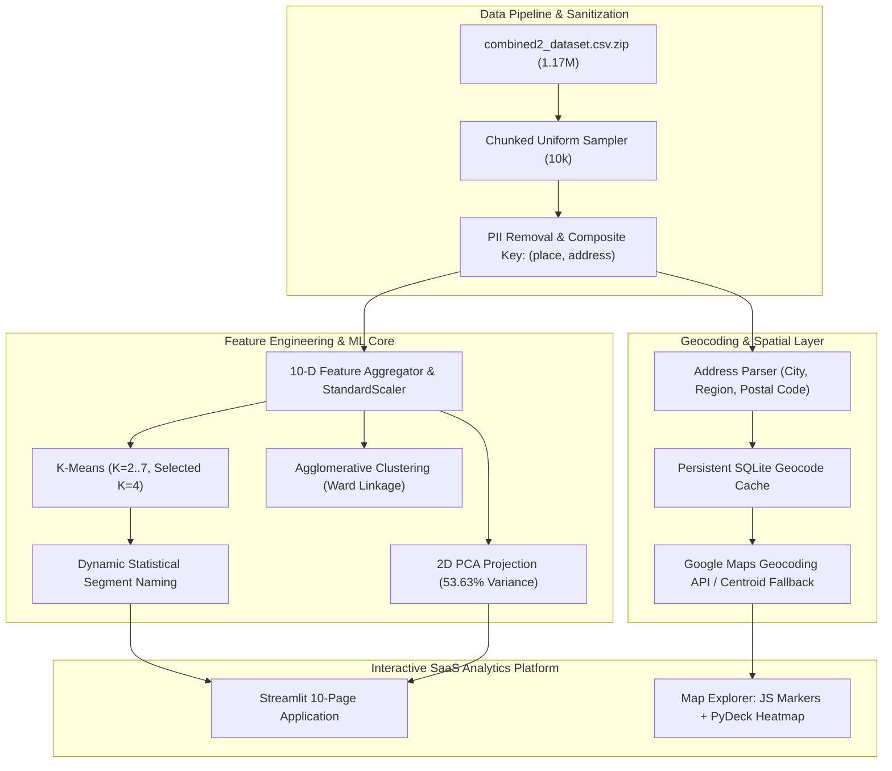

# UrbanPulse AI: Business Review Pattern Segmentation & City Intelligence

[](https://github.com/Jayant-Hu/Business-Review-Pattern-Segmentation-Using-Clustering/actions/workflows/ci.yml)
[](https://www.python.org/downloads/)
[](https://opensource.org/licenses/MIT)
[](https://streamlit.io)
[](https://www.docker.com/)

An enterprise-grade Unsupervised Machine Learning platform and civic intelligence system that analyzes 1.17M+ Google Local commercial reviews, segments establishments based on multidimensional behavioral patterns, and provides civic recommendations alongside interactive Google Maps geospatial exploration.

---

## 🏛️ System Architecture



---

## ⚡ Key Highlights & Core Findings

1. **Entity Identification**: Rigorous auditing revealed that the raw column `Id` corresponds to the **Reviewer ID**, not the Business ID. Aggregating by `Id` collapses unique storefronts into user profiles. The system constructs a composite key: `(place, address)` to eliminate conflation.
2. **Optimal Cluster Selection ($K=4$)**:
   - Evaluated across $K \in [2, 7]$ using WCSS (Inertia), Silhouette (Euclidean & Manhattan), and Davies-Bouldin Index.
   - $K=4$ was selected as the Pareto optimal balance between mathematical cohesion ($0.4320$ Euclidean / $0.5143$ Manhattan) and municipal operational actionability.
3. **Data-Driven Segment Naming**: Labels are dynamically inferred from profile distributions, preventing breakage when models are retrained.
4. **Reproducibility & Stability**: Validated across 5 random seeds using Adjusted Rand Index (**Mean ARI = 0.9986** or **99.86%**).
5. **Geospatial & Map Integration**: Dual-engine rendering using native **Google Maps JavaScript API** (with clustering) and **PyDeck / OpenStreetMap** fallback with density heatmaps and municipal hotspot ranking.

---

## 📋 Discovered Segments & Civic Policy Directives

| Cluster | Segment Name | Businesses | Avg Rating | Neg % | Strategic City-Service Action |
|:---:|:---|:---:|:---:|:---:|:---|
| **0** | **High-Satisfaction Top Tier** | 1,836 | 4.57 ⭐ | 0.1% | Feature in municipal tourism showcases & merchant leadership |
| **1** | **Moderate / Mixed Feedback** | 487 | 4.33 ⭐ | 0.0% | Offer local digital marketing & engagement support workshops |
| **2** | **High-Engagement Detailed Feedback** | 157 | 3.81 ⭐ | 14.7% | Target with operational benchmarking & culinary certifications |
| **3** | **Critical Intervention / At-Risk** | 796 | 2.33 ⭐ | 45.6% | Service quality audits, municipal inspections, staff training subsidies |

---

## 🚀 Quick Start Guide

### 1. Installation
Clone the repository and set up a virtual environment:
```bash
git clone https://github.com/Jayant-Hu/Business-Review-Pattern-Segmentation-Using-Clustering.git
cd Business-Review-Pattern-Segmentation-Using-Clustering

# Create virtual environment
python -m venv .venv
source .venv/bin/activate  # On Windows: .venv\Scripts\activate

# Install dependencies
pip install -r requirements.txt
pip install -r requirements-dev.txt
```

### 2. Configure Environment Variables
Copy `.env.example` to `.env`:
```bash
cp .env.example .env
```
*(Optional: Add your `GOOGLE_MAPS_API_KEY`. If left empty, the application automatically uses OpenStreetMap / PyDeck without crashing).*

### 3. Run Pipeline CLI
Run the entire end-to-end data, ML, and geocoding pipeline:
```bash
python scripts/run_pipeline.py --step all
```

### 4. Launch SaaS Dashboard
Start the production Streamlit application:
```bash
streamlit run app.py
```
Open **[http://localhost:8501](http://localhost:8501)** in your browser.

---

## 🐳 Docker Usage

Build and run using Docker Compose:
```bash
# Build and run container
docker compose up --build -d

# Check health and logs
docker compose logs -f

# Stop container
docker compose down
```

---

## 🧪 Testing & Code Quality

Run unit and integration test suite:
```bash
pytest tests/ --cov=src --cov-report=term-missing
```

Run lint and formatting checks:
```bash
ruff check src/ tests/
black --check src/ tests/
```

---

## 📁 Project Directory Layout

```
Business_Review_Clustering/
│
├── dataset/
│   ├── raw/
│   │   └── combined2_dataset.csv.zip     # Original raw dataset (1.17M records)
│   ├── sample/
│   │   └── sample_10k_reviews.csv        # Uniformly sampled 10,000 review records
│   └── processed/
│       └── cleaned_reviews.csv           # PII-sanitized & deduplicated reviews
│
├── src/
│   ├── data/                             # Data loading, cleaning, and schema validation
│   ├── features/                         # 10-dimensional business aggregation
│   ├── models/                           # Sklearn Pipelines (K-Means, Ward, PCA, Stability)
│   ├── geo/                              # City parser, geocoding cache, and multi-tier geocoder
│   ├── services/                         # Real-time analytics, segment naming, hotspot ranking
│   ├── ui/                               # Dark navy styling, glassmorphism components, charts
│   ├── pages/                            # 10 modular dashboard page renderers
│   └── utils/                            # Paths (pydantic-settings), logging, exceptions
│
├── scripts/
│   └── run_pipeline.py                   # Automated pipeline execution CLI
│
├── tests/
│   └── test_pipeline.py                  # Pytest unit and integration test suite
│
├── output/
│   ├── graphs/                           # High-res publication plots (300 DPI)
│   ├── models/                           # Persisted Sklearn pipelines and PCA models
│   ├── reports/                          # Comprehensive academic reports
│   └── results/                          # Exported analytical CSV data
│
├── .github/workflows/ci.yml              # Multi-version CI testing & Docker build
├── Dockerfile & docker-compose.yml       # Production containerization
├── Makefile                              # Developer shortcuts
├── requirements.txt                      # Production dependencies
├── requirements-dev.txt                  # Testing and development tools
├── pyproject.toml                        # Build and tool configs (black, ruff, pytest)
├── config.py                             # Backward-compatibility alias
└── app.py                                # Thin entrypoint and page router
```

---

## 📜 License
Distributed under the MIT License.
