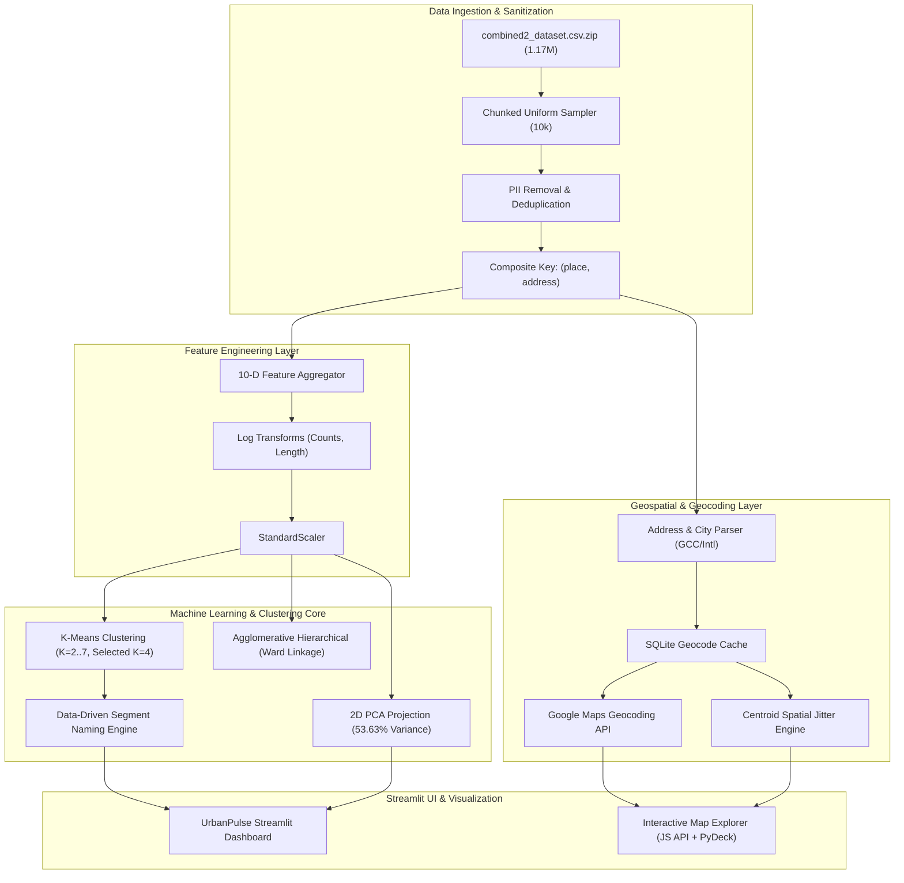

# UrbanPulse AI: Architecture & System Design

## 1. Overview
UrbanPulse AI is an unsupervised machine learning and civic intelligence platform that analyzes commercial business reviews from Google Local / Maps, segments businesses according to behavioral signatures, and provides targeted city-service recommendations and spatial geospatial exploration.

---

## 2. Architecture Diagram

---

## 3. Core Modules

| Module Path | Responsibility |
|:---|:---|
| `src/data/` | Chunked raw streaming, schema validation, deduplication, and PII sanitization. |
| `src/features/` | Aggregation from review transactions to business profiles. |
| `src/models/` | K-Means sklearn pipeline, Ward agglomerative clustering, PCA, stability analysis (ARI). |
| `src/geo/` | Multilevel geocoding (Google Maps API + SQLite cache + city centroid jitter). |
| `src/services/` | Data-driven cluster naming, real-time KPI aggregations, and city hotspot ranking. |
| `src/ui/` | Glassmorphism components, dark navy styles, and responsive Plotly visual builders. |
| `src/pages/` | Modular page renderers (Overview, Dataset, Review Analytics, Models, PCA, Metrics, Segmentation, Recommendations, Map Explorer). |
